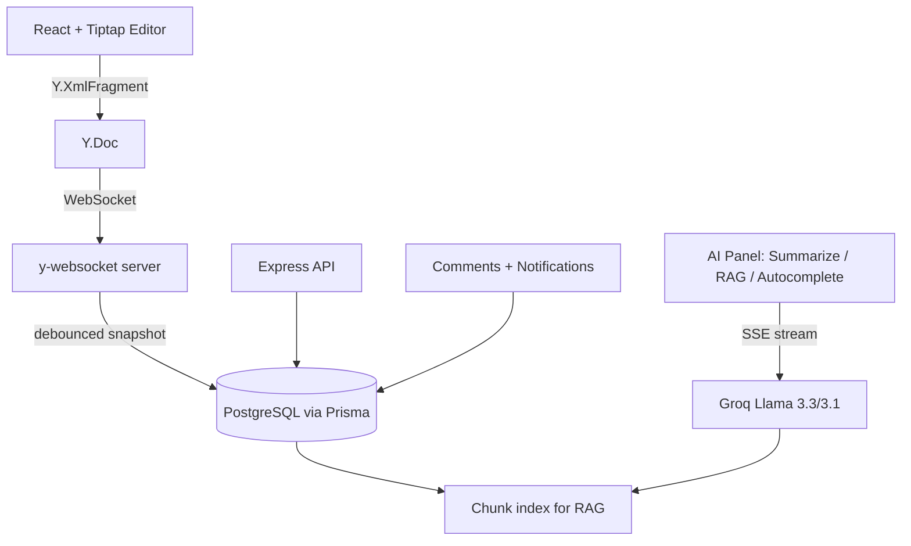

# LiveCollab AI


Real-time collaborative document workspace (Notion/Google-Docs style) with a built-in AI assistant —
summarization, RAG Q&A with citations, inline autocomplete, threaded comments, and notifications.

## Architecture



## Architecture decisions

**Yjs vs. PostgreSQL split.** Yjs owns live collaborative state — cursors, presence, and the CRDT
document itself. PostgreSQL owns durable app data: users, permissions, comments, and human-readable
version history. Yjs updates are periodically debounced and snapshotted into `document_versions`.

**RAG citation approach.** Each document is chunked and scored against a question using an in-app
hashing-based similarity search, tagged with `currentRevision` at index time. The top-k chunks are
sent to the LLM alongside the question, and the response cites `[chunk N]` inline per claim.

> **Current build note:** pgvector isn't installed on the dev Postgres yet, so retrieval uses an
> in-app similarity search (`server/src/ai/embeddings.ts`) instead of real vector embeddings — same
> interface, swap-in-ready once `CREATE EXTENSION vector;` is run.
>
> AI calls use Groq's free API (Llama 3.3 70B / 3.1 8B) rather than a paid provider, so the project
> runs end-to-end with zero API cost.

**Comments & notifications.** Comments anchor to a `fromPosition`/`toPosition` text range and support
one level of threaded replies. New comments/replies generate a `Notification` row for the relevant
users; the client polls both endpoints on a short interval as a lightweight stand-in for push delivery.

## Stack

- **Frontend:** React + Vite + TypeScript + Tailwind + Zustand + TanStack Query + Tiptap + Yjs
- **Backend:** Node.js + Express + TypeScript + Prisma + PostgreSQL
- **AI:** Groq (Llama 3.3/3.1), SSE streaming, in-app similarity search
- **Auth:** JWT access token + HttpOnly refresh cookie
- **Realtime:** y-websocket for CRDT sync; polling for comments/notifications

## Setup

```bash
# server
cd server
cp .env.example .env
npm install
npx prisma generate
npm run dev             # http://localhost:4000

# client (new terminal)
cd client
cp .env.example .env
npm install
npm run dev              # http://localhost:5173
```

## Build order / phase status

- [x] Phase 1 — Foundation (monorepo, Prisma schema, auth)
- [x] Phase 2 — Collaboration (Tiptap + Yjs + y-websocket, presence, autosave)
- [x] Phase 3 — Documents (CRUD, folders, RBAC, sharing, version history + rollback, dashboard)
- [x] Phase 4 — AI (chunking, summarize, RAG Q&A with citations, autocomplete)
- [x] Phase 5 — Comments (threaded, anchored to text) + notifications
- [x] Phase 6 — Production hardening (Vitest unit/integration tests, GitHub Actions CI, Docker + docker-compose, health checks, structured logging, rate limiting, Zod validation — all already in place from earlier phases)
- [ ] Phase 7 — Deployment


## Testing

```bash
# server (auth flow, validation schemas)
cd server && npm test

# client (utils)
cd client && npm test
```

## Docker

```bash
GROQ_API_KEY=your_key_here docker compose up --build
```

Spins up Postgres (with the pgvector extension pre-installed, ready for when the
in-app similarity search in `server/src/ai/embeddings.ts` is swapped for real
vector embeddings), Redis, the API server, and the client — no local Node/Postgres
install needed.

## CI/CD

`.github/workflows/ci.yml` runs on every push/PR to `main`: install → typecheck →
test → build, for both server and client, in parallel jobs.
